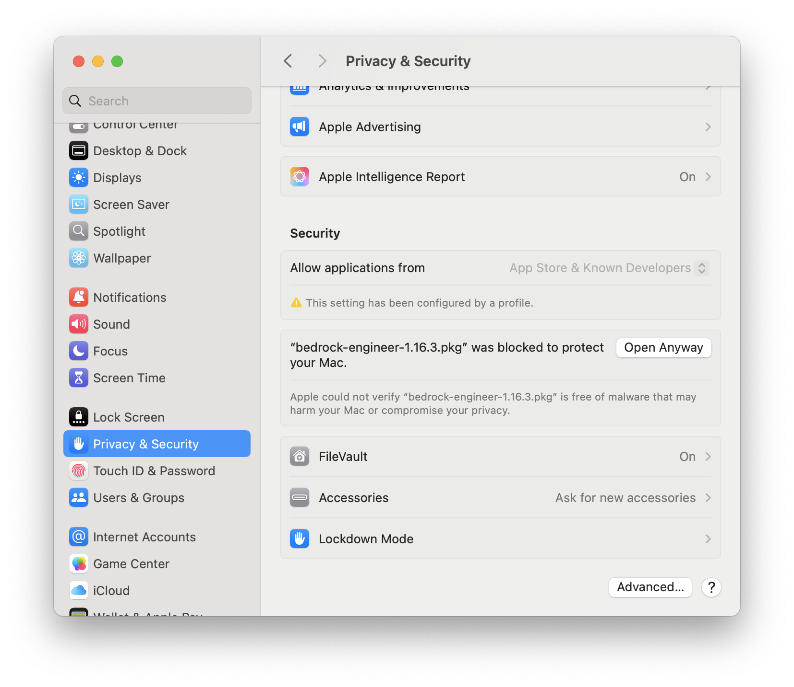

# Bedrock Engineer (Rust fork)

Original code here: https://github.com/aws-samples/bedrock-engineer

This repository is a fork of the original code with updates that deviate from upstream. Upstream
changes are no longer included in this fork. This fork is maintained independently and contains new
features and updates to keep models current. In addition, this fork moves from Electron to
Rust/Tauri.

Builds from this repo are versioned by date rather than with the original versioning scheme
(`YYYY.MMDD.N`): for example, version 2026.629.1 was the second change committed on 2026-06-29.

Bedrock Engineer is a desktop app for macOS, Windows and Linux that runs autonomous AI agents on
[Amazon Bedrock](https://aws.amazon.com/bedrock/), in your own AWS account. Agents can create and
edit files, run commands (on your machine with approval, or in a per-chat Docker sandbox), search
the web, query Bedrock Knowledge Bases, call Bedrock Agents and Flows, generate images and video,
use tools from MCP servers, and hand work to one another. Alongside the agent chat there are
scheduled background agents, an agent directory, and generators for websites, AWS architecture
diagrams and Step Functions workflows.

**New to the app, or looking for how something works?** The [User Guide](./docs/USER_GUIDE.md) is a
complete, plain-language walkthrough of every screen, every tool and every setting, with a question
index and a troubleshooting section. It is bundled into the app: the **Help** button opens it, with
search, and offers a chat that answers from it.

The dated changelog is in [CHANGELOG.md](./CHANGELOG.md); its newest dated section is published as
the release notes for each build.

## Install

### Download

Installers for every build are attached to this fork's releases:

[](https://github.com/ibehren1/bedrock-engineer-rust/releases/latest)

| System                          | File                                                         |
| ------------------------------- | ------------------------------------------------------------ |
| macOS (Apple silicon and Intel) | `bedrock-engineer-rust-<version>-universal.dmg`              |
| Windows                         | `bedrock-engineer-rust-<version>-x64.setup.exe`              |
| Linux                           | `bedrock-engineer-rust-<version>-x64.AppImage` or `-x64.deb` |

### macOS

1. Open the DMG, accept the license, and drag **Bedrock Engineer** into Applications.
2. **Let Terminal manage apps (required).** macOS 15 and later protect everything in Applications:
   until Terminal is allowed to change installed apps, the signing step below fails with
   `Operation not permitted`, and the app can hang on launch — no window, no error — while macOS
   waits on a security check it can't finish. Open **System Settings → Privacy & Security → App
   Management**, turn on **Terminal**, then quit and reopen Terminal so the change takes effect.
3. **Sign the app on your Mac (required).** Bedrock Engineer is self-signed (ad hoc), not signed with
   an Apple developer certificate, so each install has to be signed on the machine it runs on. Run
   this in Terminal after every install or update, before opening the app:

   ```bash
   sudo codesign --force --deep --sign - "/Applications/Bedrock Engineer.app"
   sudo xattr -dr com.apple.quarantine "/Applications/Bedrock Engineer.app"
   ```

   The first command signs the app; the second clears the download flag your browser set, which is
   what makes macOS stall on first launch. Without them the app may not open at all, or may not work
   correctly — including the system permission dialogs for screen recording and the camera. From a
   checkout of this repo, `make sign` does the same.

4. Open the app. The first time, macOS may say it can't verify the developer, or that the app was
   blocked, because it isn't distributed through the Mac App Store. Click **Done**, open **System
   Settings → Privacy & Security**, scroll down to the Security section, find "Bedrock Engineer was
   blocked to protect your Mac", and click **Open Anyway**.

   

5. macOS asks for **Screen Recording** and **Camera** permission the first time an agent uses the
   screen or camera capture tools.

### Updates

After the first install, the app keeps itself up to date. It checks the GitHub releases at launch
and every hour, downloads a new version in the background, and offers **Restart now** /
**Later**; Later installs it the next time you quit. Each download is checked against the app's
update signing key before it is installed. **Settings → Updates** shows the version you are
running, turns automatic checks off and on, checks on demand, and lists the changes in the version
you are running (and in a newly downloaded one, before you restart into it).

On macOS, an update the app installs itself needs none of the Terminal steps above: it never
carries the browser's download flag. Two things to know:

- macOS 15 and later may ask you to let **Bedrock Engineer** manage apps the first time it updates
  itself (**System Settings → Privacy & Security → App Management**). If an update fails with a
  permission error, turn it on there and check again.
- Because the app is signed ad hoc, macOS treats each version as a new app and asks for **Screen
  Recording** and **Camera** permission again after an update.

The Linux `.deb` doesn't update itself; the AppImage does.

### Windows

Run the setup program. It isn't code-signed, so SmartScreen may show "Windows protected your PC":
click **More info**, then **Run anyway**. The app uses Microsoft Edge WebView2, which the installer
downloads if it is missing.

### Linux

Make the AppImage executable and run it (`chmod +x bedrock-engineer-rust-*.AppImage`), or install
the `.deb` with `sudo apt install ./bedrock-engineer-rust-<version>-x64.deb`. Both need a 2024-era
or newer distribution (glibc 2.39 or later): for example Ubuntu 24.04, Debian 13 or Fedora 40.

### Set up AWS access

The app has no AI of its own: every answer comes from a model in Amazon Bedrock in your AWS account,
billed by AWS. Open **Settings → AWS** and enter an access key and secret, or the name of an AWS
profile, and pick a region. If Bedrock is new to you, follow
[Setting up access to Amazon Bedrock](./docs/USER_GUIDE.md#4-setting-up-access-to-amazon-bedrock). It
covers enabling models in the Bedrock console, the IAM policy, creating access keys, installing the
AWS CLI, and writing the `~/.aws/credentials` and `~/.aws/config` files.

### Where settings and history live

Settings (`config.json`), chat history (`chat-sessions/`, `chat-sessions-meta.json`), memory items
(`memory.json`), local knowledge bases and the downloaded on-device embedding model
(`knowledgebases/`) and logs (`logs/`) are kept in one folder named after the app:

| System  | Folder                                            |
| ------- | ------------------------------------------------- |
| macOS   | `~/Library/Application Support/Bedrock Engineer/` |
| Windows | `%APPDATA%\Bedrock Engineer\`                     |
| Linux   | `~/.config/Bedrock Engineer/`                     |

This is separate from upstream Bedrock Engineer's `bedrock-engineer` folder. Builds of this fork
from before the rename used a different folder name; the app moves that folder to the new location
the first time it starts. The exact path is shown in **Settings → Workspace → Config Directory**.

If the app won't start because of a configuration error, move `config.json` out of that folder and
start the app again. If it still fails, please file an issue.

## What's different in this fork

### A native app, built in Rust

Upstream Bedrock Engineer is an Electron app. This fork runs the same React interface in
[Tauri](https://tauri.app/) with a Rust backend (`src-tauri/`) in place of Electron's Node.js main
and preload processes: Bedrock calls, tools, MCP clients, the Docker sandbox, background agents and
settings storage are all Rust. The installers are much smaller and the app starts faster, because
it no longer ships its own copy of Chrome and Node.js — it uses the operating system's web view
(WebKit on macOS and Linux, WebView2 on Windows).

Settings, agents and chat history from the Electron builds of this fork carry over on first launch.
On macOS the Tauri app has a new identity, so the system asks once more for Screen Recording and
Camera permission. Voice Chat (Nova Sonic) did not come along.

### Help, without leaving the app

A **Help** button sits in the bottom-left corner, just above the GitHub link. It opens the user guide
inside the app, with a table of contents, working section links and a search box. The guide page
needs no AWS access and no internet connection, so it works on a fresh install before anything is
set up. The guide is bundled into the build, so it always matches the version you are running.

**Ask a question** on that page opens a chat called "Bedrock Engineer Help". For each question the
app searches the guide and gives the model only the sections that match, and the answer names the
section it came from. The search uses an index of the guide that ships with the app (built with the
on-device embedding model), so there is nothing to download or build. It matches by keyword, and by
meaning too if you have downloaded the on-device model for local knowledge bases. The chat itself
needs Amazon Bedrock; the guide page says so, and links to the setup section, until it works.

The help chat runs on whichever model you chose as the **Light Processing Model** in Settings,
falling back to your main conversation model. It deliberately has no tools, so it cannot read your
files or inspect your settings. It answers from the guide and says so when the guide does not cover
your question. Asking again continues the same conversation rather than starting a new one.

### My Agents

Agents are created and maintained on a **My Agents** page that opens in the main window, with its
own sidebar button. It replaces the "Custom Agents" overlay that upstream opens on top of the chat.


- Create, edit, duplicate, export and remove agents from one place. Clicking an agent opens its
  editor rather than switching the active agent.
- **Move agents in and out as files.** **Download YAML** in an agent's ⋮ menu writes its
  configuration to a file you pick, stripped of the internal id and the flags recording where your
  copy came from so it is portable. **Import Agent**, beside Add New Agent, reads such a file back in
  as one of _your_ agents — editable, with a fresh id, rather than the read-only kind you get from a
  project's shared folder.
- **Un-share an agent.** Once an agent has been written into a project's
  `.bedrock-engineer/agents/` folder, **Delete Shared File** in its ⋮ menu removes that file after
  confirming the full path. Your own copy is untouched; only the copy everyone opening the project
  sees goes away. Upstream has no way to undo sharing from inside the app.
- **Hide the built-in agents you don't use.** Upstream re-seeds its built-in agents into the store
  on every launch, so deleting one never stuck. **Hide** now persists across restarts, and the
  **Unhide** dropdown lists every hidden agent so you can bring them back one at a time or all at
  once. Agents you created yourself are deleted outright instead of hidden.
- **Rearrange agents by drag and drop**, in either card or table view. The arrangement is saved and
  is reused by the agent dropdown and `@` mentions. Dragging is disabled while a table column sort
  is active.


### Picking an agent icon from ~38,000 icons

The icon button in an agent's **Name & Icon** row opens a picker that still starts on the curated,
categorised list, and adds ten icon collections to browse or search by name — Tabler, Lucide,
Phosphor, Material, Heroicons, Bootstrap, Font Awesome (plus brands), Simple Icons and Game Icons.
Choose **All libraries** to search across all of them at once; long result lists are capped, so
narrow the search to see more. Collections are loaded the first time you open one, so app startup is
unaffected, and icons chosen before this change keep working.

### Choosing an agent from the message entry area

The agent picker is a dropdown in the message entry area, left of the model selector, and the three
controls there are labeled **Agent**, **Model** and **Thinking**. "Edit agents" jumps to the My
Agents page.


### Delegating a task to another agent with `@`

Type `@` followed by an agent name to hand one step of a task to that agent. The other agent runs
with its own tools and system prompt, and its result comes back to the agent you are talking to — no
switching back and forth. For example, `use @email to find the email from Kevin and compose a reply`.


### Finding MCP servers

The agent editor's **MCP Servers** tab searches the
[official MCP Registry](https://registry.modelcontextprotocol.io) — type a term, or press **Suggest
for this agent** to have the model derive the search terms from the agent's description, system
prompt and enabled tools.


Every server listed comes from the registry, so names, versions, package identifiers, required
environment variables and hosted endpoints are real: "Load config" fills the JSON editor with a
version-pinned command (or the remote URL) for you to review before adding it. The model only ever
produces the search terms, never a package name.

Those terms have to be grounded in the agent's own configuration — its system prompt, scenarios,
allowed shell commands, description and additional instruction — and each one is shown with the
phrase it came from. A support agent whose prompt mentions Zendesk, Stripe, Snowflake, Linear and
Slack gets exactly those five searches, not "automation" or "devops"; generic category words are
rejected, and if nothing in the configuration names a system, it says so rather than guessing.

[MCP Market](https://mcpmarket.com) is linked for browsing by category, chosen from the same agent
signals. It's link-out only: it publishes no API, its `robots.txt` disallows `/api/` for everyone,
and automated requests get a Vercel bot challenge, so the app doesn't read it.

MCP servers started with `npx`, `uvx` and similar commands see your login shell's `PATH` on macOS
and Linux, even when the app is opened from the Dock or a desktop launcher. Configuration details
are in the [MCP Server Configuration Guide](./docs/mcp-server/MCP_SERVER_CONFIGURATION.md).

### AWS Solutions Architect agent

The **AWS Solutions Architect** agent in the Agent Directory answers AWS questions from the official
documentation and links each point to its source. Add it to My Agents to use it and adjust it like
any agent of your own. It comes with four AWS MCP servers already set up: AWS Documentation, the
hosted AWS Knowledge server (which also covers Regional availability), the Infrastructure as Code
server (CloudFormation validation, compliance checks, deployment troubleshooting and CDK guidance,
and it never deploys), and AWS Pricing for cost estimates. Three of them run with `uvx`, so install
[uv](https://docs.astral.sh/uv/) first.

The servers that call AWS use the credentials from **Settings → AWS**. Any MCP server can do the
same by putting `{{awsProfile}}` and `{{awsRegion}}` in its `env`. With an access key instead of a
profile, the key pair is passed. Servers that don't use the placeholders never see your
credentials.

### Chat interface


- Each turn is labeled with your configured **user name** and avatar, and with the **model icon** of
  the model that produced the answer (hover it for the model name).
- **Tabs across the top of the chat** switch between the conversation and everything around it:
  **Chat**, **Files**, **Sandbox**, **Todo**, **Cost** and **System prompt**. Files appears when a
  project folder is set, Sandbox when the chat has a Docker sandbox, Todo once the agent has made a
  todo list (its label counts the finished items), and Cost once the chat has messages (its label
  shows the running cost; the tab has the token and cost charts). The message box stays at the
  bottom on every tab, and sending a message switches back to Chat. Each chat remembers the tab you
  left it on.
- **A terminal on your own computer.** The terminal button above the message box opens your usual
  shell, started in the project folder, on a **Terminal** tab. A chat can have several shells as
  sub-tabs (**+** adds one, **×** closes it). They keep running while you switch tabs or chats and
  end when you close them, delete the chat or quit. The agent cannot reach them: there is no tool
  for them.
- **Export the conversation** as Markdown, Word (`.docx`) or PDF from the buttons above the input
  box. All three exclude tool use/results, label turns as `Assistant – <model ID>` / `User – <name>`,
  and embed the avatars. Word and PDF render Mermaid and DrawIO diagrams as images; the Markdown
  export keeps Mermaid diagrams as ` ```mermaid ` code blocks so they stay editable and are
  rendered by GitHub, VS Code and Obsidian, and writes DrawIO diagrams and other images to an
  `images/` folder next to the `.md` file.
- Select text in a message to get a **floating toolbar** that copies just the selection as Markdown
  or rich text; whole messages can be copied either way too.
- The stop-generation button is red while inference runs; the new-conversation button is green.
- **Answers keep running in the background.** Switching to another chat, starting a new one, or
  leaving the Chat page no longer cancels an agent mid-turn — it keeps calling tools and the reply is
  waiting when you return. Chats still working are marked "Still responding" in the history list, and
  stop only ever stops the chat on screen. Reloading the window still cancels everything.
- The **chat history** is docked on the left and starts open when you go to Chat. Collapse it to a
  narrow rail with a New chat button and the recent chats as initials.
- Each chat in the history carries a **paperclip** when it has attached files and a **whale** when it
  has a Docker sandbox, both in the row's own text colour, so you can see which conversations have
  something on disk behind them without opening each one.
- Streaming output auto-scrolls through the tool-use phase and then stops, and respects a manual
  scroll up.
- **Attachments are files in your project, per chat.** Drop, paste or pick a file and it is written
  to `attachments/<chat-title>-<id>/` immediately — images included, so nothing is held in the
  message box. A paperclip button next to the export buttons badges the file count and opens a menu
  to list, delete, add and reveal them. Their contents are rebuilt from the folder on every message,
  so editing or removing a file changes what the agent sees next without re-attaching; long files are
  trimmed with a pointer to read the rest, and formats nothing can extract are passed along as paths.
  Deleting the chat deletes its attachments folder.
- Chat history supports multi-select delete.

### Memory

Rules and facts you want every chat to know live in one shared memory list.

- Say "add a rule: always use TypeScript", "remember that prod is eu-west-1" or "forget the pnpm
  rule" and the agent saves, changes or removes the item with its memory tools. The reply shows a
  note with **View** (opens the Memory page) and **Undo**.
- Each item is a **rule** or a **memory**. A rule is an instruction the agent always follows unless
  you tell it otherwise in that chat ("use pnpm instead of npm"). A memory is a fact it keeps in mind
  and uses when relevant, as background rather than an instruction ("the main repo is at
  ~/work/app"). The two go into the system prompt as separate sections, worded that way.
- The **Memory** page in the sidebar explains the two kinds and lists every item. You can add items,
  edit their text, switch an item between rule and memory, switch single items off without deleting
  them, and delete them.
- The **brain button** next to the attach and export buttons above the message box adds every
  switched-on item to the system prompt, which you can see on the System prompt tab. It is
  highlighted (with a count of the items) while on, starts on for each new chat, and turning it off
  only affects that chat.

### Accounting

The **Accounting** page in the sidebar shows what the app's model calls are estimated to cost on
Amazon Bedrock.

- Every model call the app makes is recorded. That includes chats, the Website, Diagram and Step
  Functions generators, background agents and sub-agents, chat titles, the agent editor's
  generators, and knowledge base indexing and search with Bedrock embeddings. Each call is priced
  at the moment it happens and the record is kept forever, so you can look back at any month.
- Pick a month to see its total so far, the previous month's total, a chart of cost per day
  stacked by model, a chart of cost per month (click a bar to open that month), and tables by
  model, by feature and by day, with input, output and cache tokens next to the cost.
- Click a model, feature or agent in its table to narrow the whole page to it. The list of
  individual calls at the bottom shows when each one happened and what it cost.
- The chat history list shows what each chat has cost, and a background task's history shows the
  cost of each run.
- A tile shows how much prompt caching saved this month.
- **Export CSV** saves every call of the month (or of the current filter) for a spreadsheet.
- On first launch, the usage your chats already saved is imported, so earlier months aren't
  empty. Before this feature only chats recorded their usage, so those months show chat cost only;
  imported calls are marked.
- Image generation (per image), Nova Reel video (per second), Bedrock Agents (from their traces),
  guardrails (per text unit) and Amazon Translate (per character) are recorded and priced too; the
  tables show those units next to the tokens. Knowledge Base retrieval and Flows report no usage,
  so they are counted but not priced.
- Set a **monthly budget** on the page. You get a notification the first time the month's
  estimated cost reaches each alert level (80% and 100% unless you change them), the `$` icon in
  the sidebar gets a red dot while you're over, and the page shows how much is used and where the
  month is heading at the current pace.
- Figures are estimates from on-demand list prices. Where a model's pricing differs by
  inference profile (global vs. a geography) or for very long prompts, and the catalog records
  how, that is applied. Calls through your own application inference profiles are priced as the
  model the profile uses. Your AWS bill is the final word: discounts, taxes and pricing details
  the catalog doesn't record can differ. Calls to models with no known
  price are counted but left out of the totals and flagged. Cohere embedding tokens are estimated
  from text length.

### Local knowledge bases

An agent can search documents and websites you give it, all stored on your computer.

- The **Knowledge Base** tab in the agent editor (after MCP Servers) holds the agent's knowledge
  bases. Create one with a name and a short description; the description tells the model what it
  covers.
- **Add files** takes text, Markdown and code files, PDF, Word, HTML, Excel and PowerPoint. **Add
  folder** adds a folder as one source that follows it: files added, edited or deleted in it are
  picked up at the next sync (hidden, dependency and build folders are left out). **Add
  website** crawls a site with the app's own crawler. It starts at the URL you give, stays on that
  site (and under that folder, unless you turn that off), follows links up to the depth and page
  limit you set, reads sitemap.xml, honors robots.txt and waits between requests.
- Sources are processed in the background with a progress bar, and can be stopped. **Re-sync**
  picks up changes and skips documents that are unchanged. File and folder sources also re-sync
  on their own when their files change, checked at startup and then hourly (the interval is a
  setting); websites only when you ask. **Remove** takes a source and its
  passages out again. A search box on the tab shows what the agent would find for a question.
- An agent with a knowledge base gets a built-in MCP server, `local-knowledgebase`. Its
  `searchKnowledgeBase` tool returns the most relevant passages, ranked by both meaning and
  keyword matches, with the file path or page URL they came from (`listKnowledgeBases` and
  `listKnowledgeBaseSources` let it see what is there). Its system prompt lists the
  knowledge bases and asks the agent to search them and cite its sources. Background agents and
  sub-agents get the same tools. The agent editor's **MCP Servers** tab shows the server as
  **Built-in** with its tools and a **Test connection** button, and the **Tools** tab lists the
  tools with the other MCP tools. In a chat, each search shows up as a `searchKnowledgeBase` tool
  call with the query and the passages it returned.
- **Settings → Knowledge Base** picks the embedding model for new knowledge bases: Amazon Titan
  Text Embeddings V2 or Cohere Embed on Bedrock, or **multilingual-e5-small** running on your
  computer (works offline and covers about 100 languages; a one-time download of about 465 MB). The
  tab also has chunk size, the number of results, the balance between meaning and keyword matches,
  the crawler's defaults, and a list of every knowledge base on disk with its size and a delete
  button, including any left behind by deleted agents.
- Each knowledge base card shows tiles for passages, storage (with the space an optimize would
  give back), agent searches over 30 days with a per-day trend, and the typical search time, plus
  a health badge and a **Maintenance** panel. The panel lists anything that needs attention
  (failed sources, websites not synced for 30 days, a missing local model, a model that differs
  from Settings, free space) and has an **Optimize** button. Optimize compacts the file, tidies
  the keyword index and checks for errors, and also runs on its own after an update that leaves
  a lot of free space. **Settings → Knowledge Base** opens with an **Overview** of every knowledge
  base: totals, then a table with each one's agent, model, size, searches, search time, last use
  and health, with **Optimize all**.
- Each knowledge base is one SQLite file under `knowledgebases/` in the app's data folder. It keeps
  the model it was built with; when Settings name a different one, the agent editor offers a
  rebuild. Duplicating an agent copies its knowledge bases and deleting the agent deletes them.
  They are never written into shared or exported agent files.

### Files tab

The chat's **Files** tab shows the project folder, so the agent's output is one click away.

- Open it from the tab strip or with the **Files** button above the message box. When the agent
  creates or changes files, the tab shows how many with a fuchsia count that pulses briefly and
  stays until you look (no animation when the system asks for reduced motion).
- Click a file to preview it: text and code with syntax highlighting and line numbers, Markdown
  (rendered or as source), HTML, images, PDF (page by page, with zoom) and Word documents. Text
  files can be edited and saved; if the file changed on disk in the meantime, you are asked before
  anything is overwritten.
- Drag the divider between the file list and the preview to make the list wider or narrower (the
  arrow keys move it too, and a double-click resets it); the width is remembered. After clicking in
  a preview, ⌘A (Ctrl+A on Windows and Linux) selects just that file's content.
- **Open** opens the file in its default app, **Reveal** shows it in Finder or Explorer, and the
  header button opens the whole project folder.
- **Pop out** opens the file in a window of its own (one per file; popping out the same file again
  brings its window forward), with the same preview, editing and buttons. It follows changes on
  disk, says so if the file is deleted, and asks before closing over unsaved edits.
- **This chat** lists only the files the agent created or changed in the current chat. Those files
  carry a fuchsia dot in the full tree as well, and the folders holding them open automatically
  (a folder you collapse stays collapsed).
- The tree refreshes as files change, and file paths in the agent's replies are links that open the
  file on the Files tab.

### A Docker sandbox per chat

Turning on the **Docker Sandbox** tool gives each chat its own long-lived container, and makes it the
default place the agent runs commands. The agent can install whatever it needs (`apt-get` or `dnf`) and make a mess without any of it reaching your machine — and because it
cannot reach your machine, the command allowlist doesn't have to hold it back inside the container.

- Pick the container's operating system in **Settings → Sandbox**, next to the memory, CPU and
  command timeout limits: Debian 13 (the default — the quickest to download and install packages
  on), Ubuntu 26.04, Amazon Linux 2023 or 2027, AlmaLinux 9, Rocky Linux 9 or Red Hat UBI 9. UBI is
  real RHEL but only has Red Hat's freely available package subset. The agent can also ask for a
  different OS for one chat's sandbox. Firecracker microVMs aren't offered: they need KVM, which
  Docker on macOS and Windows doesn't provide.
- Your project directory is mounted read-write at `/workspace`, so files move in and out freely, and
  the agent can publish ports if you want to open what it built in a browser. Long-running processes
  can be started in the background and their output read back later.
- Running a command on **your own machine** instead has to be asked for explicitly, and you get a
  dialog with the exact command before anything runs — allow it once, or for the rest of that chat.
- The Docker whale next to the export buttons appears whenever the current chat has a container, and
  can stop, start or remove it, open its folder in Finder, Explorer or your Linux file manager, and
  switch to the Sandbox tab.
- **A Sandbox tab** appears in the chat's tab strip, with a fuchsia dot until you first look. It
  shows what the container actually is — image, how long it has been up, CPU, memory, network and disk
  against their limits — lists each service with its published ports as links that open in your
  browser, and keeps an **Activity** log of every command the agent ran there: when, how long it took,
  and whether it finished, failed, stopped for input, was left running in the background, or timed
  out. That log is kept in the sandbox's own folder, so it is still there after a restart.
- **A Compose tab** for stacks: a diagram of the services with their images and states, the published
  ports that reach them from your browser, the folders mounted into them, and the compose file itself
  underneath. Click the diagram to open it full window.
- **An interactive terminal** on that tab gives you a real shell inside the container, with colours,
  full-screen programs like `vim` and `htop`, resizing and Ctrl-C — and a tab per container when the
  sandbox is a compose stack. It is the fastest way to see what the agent left behind or to fix
  something by hand. Because it is a genuine root shell with your project mounted at `/workspace`,
  nothing you type is filtered or approved — the app says so once, before the first time you open it.
  The model cannot reach this shell: there is no tool for it.
- Containers survive switching chats, are stopped when you quit, and come back with their installed
  packages intact. Compose and data files live in `docker-sandboxes/<chat-title>-<id>/` in your
  project directory as ordinary mapped folders, and the folder is renamed to follow the chat's title.
- Deleting a chat removes its container; the delete dialog offers to delete the sandbox's data folder
  too, unchecked by default, so anything the agent wrote is kept unless you say otherwise.

Requires Docker (Docker Compose is used when available, and is needed for multi-service stacks). If
Docker is missing, the agent tells you how to install it for your platform. The terminal additionally
needs Docker to be local — Docker Desktop, OrbStack, Colima and rootless installs all work, but a
context pointing at a remote daemon disables that tab and says why; the rest of the panel still works.

### Models

- Added Claude Fable 5.1, Fable 5, Opus 5.5, Opus 5, Sonnet 5.5, Sonnet 5, Haiku 5.5 and Opus 4.8, Kimi K3,
  Kimi 2.5, xAI Grok 4.7 and 4.6, the OpenAI GPT-6.1 (Sol/Terra), GPT-6 (Astra/Sol/Luna) and GPT-5.6
  (Sol/Terra/Luna) models, all served through the standard Bedrock Converse API.
- Adaptive thinking for newer Claude models, with the thinking type translated per model so
  switching model generations doesn't 400. On models that expose reasoning-effort levels rather than
  a thinking budget — Grok 4.7, Grok 4.6 and the GPT-6.1, GPT-6 and GPT-5.6 models — **Deeper** asks
  for the highest effort the model offers.
- Model pricing kept current, and per-model input/output pricing shown in the model dropdown.
- **Max Tokens is capped per model.** Every request sends the lesser of your Max Tokens setting and
  the model's own output ceiling, so one high setting works across models instead of being rejected
  by the smaller ones.
- **Model allowlist** in settings, so the dropdown can be trimmed to the handful of models a given
  user should see.

### Appearance and layout


- **Settings are grouped into tabs** — General, AWS, Models, Chat, Workspace, Sandbox, Knowledge
  Base and Updates — with a sidebar down the left, rather than one long column. Each tab has its own address
  (`#/setting/aws`), so links into settings open the relevant tab.
- **Five appearances**, lightest to darkest — Light, **Newspaper**, Dim (default), **Charcoal** and
  Dark. Newspaper is a flat, monochrome, black-on-white view in the spirit of a printed page or an
  e-ink reader: square corners, hairline rules, no shadows, and colour reserved for success and error
  states. Charcoal is a warm grey with an amber accent.
- **The app has its own typeface, and you can choose it.** Text is set in Inter and code in JetBrains
  Mono by default, both bundled so they render identically on every platform with no network. Settings
  → General → Appearance offers Inter or Geist for interface text and JetBrains Mono or Geist Mono for code as
  two separate settings, because JetBrains Mono makes `1`, `l`, `I` and `0`, `O` easier to tell apart
  when you're reading a tool-use ID or a file path.
- Every text size carries a line height and letter spacing chosen for it, figures are fixed-width so
  live token counts and costs don't shift as digits change, and one set of corner radii applies
  throughout: 6px on controls, 8px on containers, fully round only for avatars and count badges.
- **The window reopens where you left it**, at the same size and position, and maximized if it was
  maximized. A position that is off-screen on the monitors you have now is brought back into view,
  and a size too large for them falls back to the default.
- **Sidebar Settings** hides any navigation icon you don't use.
- Pick an emoji avatar and a display name for yourself in the chat.
- A reworked app icon.
- Japanese translations for the AWS and Language settings, which previously showed only in English.

## More of what the app does

These features come from upstream Bedrock Engineer and work the same way here; the User Guide has
the details.

- **Tools.** File reading and writing (including Excel as CSV), command execution with an allowlist,
  web search (Tavily) and page fetching, image generation and recognition, Nova Reel video
  generation, Bedrock Knowledge Base retrieval, Bedrock Agents and Flows, a Python code interpreter
  in Docker, and screen and camera capture. Tools are switched on per agent. See
  [the complete tool reference](./docs/USER_GUIDE.md#9-the-complete-tool-reference).
- **Background agents.** Run an agent on a cron schedule, keep its conversation across runs, run it
  on demand, and get a notification with the result. See
  [Background Agent](./docs/USER_GUIDE.md#14-background-agent-work-on-a-schedule).

  

- **Agent Directory.** Browse, search and add ready-made agents, or share agents across a team
  through S3 (see the [Organization Sharing Guide](./docs/agent-directory-organization/README.md)).
  See [Agent Directory](./docs/USER_GUIDE.md#13-agent-directory).
- **Website Generator.** Generate React, Vue, Svelte or vanilla JS sites with a live preview,
  optionally grounded in a Knowledge Base (for example your design system) or in web search. See
  [Website Generator](./docs/USER_GUIDE.md#15-website-generator).
- **Diagram Generator.** Turn a description into an AWS architecture diagram in draw.io format. See
  [Diagram Generator](./docs/USER_GUIDE.md#16-diagram-generator).

  

- **Step Functions Generator.** Generate and preview Step Functions ASL definitions. See
  [Step Functions Generator](./docs/USER_GUIDE.md#17-step-functions-generator).
- **Application inference profiles** for tracking Bedrock costs by project or team. See the
  [Application Inference Profile Guide](./docs/inference-profile/INFERENCE_PROFILE.md).
- **Custom Model Import** models can be used too. See the
  [Custom Model Import Configuration Guide](./docs/custom-model-import/README.md).

## Build from source

### Prerequisites

- Node.js 24 or later.
- A Rust toolchain (stable, via [rustup](https://rustup.rs/)), plus the platform's C compiler
  below: the build compiles SQLite (for local knowledge bases) and a few other C libraries from
  source.
- **macOS:** the Xcode command-line tools (`xcode-select --install`).
- **Windows:** the Microsoft C++ Build Tools and WebView2 (see
  [Tauri's prerequisites](https://tauri.app/start/prerequisites/)).
- **Linux:** the WebKitGTK development packages Tauri needs (see
  [Tauri's prerequisites](https://tauri.app/start/prerequisites/)). The exact `apt-get` list the
  release build uses is in `.github/workflows/build-and-release.yml`.

### Build and install on macOS

```bash
make build-mac     # installs npm packages, adds the Rust mac targets, builds the universal .app + .dmg
make install       # opens the new .dmg; drag Bedrock Engineer into Applications
make sign          # sign the installed app (required, as for downloaded builds)
```

`make sign` needs Terminal enabled under **System Settings → Privacy & Security → App Management**,
same as a downloaded build; without it macOS refuses to modify anything in Applications.

The `.app` and `.dmg` are in
`src-tauri/target/universal-apple-darwin/release/bundle/`. `make build-native` builds for this Mac's
architecture only, which is faster; its output is in `src-tauri/target/release/bundle/`.

### Build on Windows or Linux

```bash
npm ci
npm run build:win      # Windows: NSIS -setup.exe
npm run build:linux    # Linux: .AppImage and .deb
```

The installers are in `src-tauri/target/release/bundle/`.

### Develop

```bash
npm ci             # once, and after dependency changes
npm run dev        # run the app; the interface hot-reloads and the Rust side rebuilds on change
make test          # Rust and JavaScript unit tests (what CI runs)
npm run typecheck && npm run lint
```

`npm run dev` uses your real settings and chat history. Other `make` targets: `make version` prints
the version the current commit builds as, `make notices` regenerates the third-party license
notices, and `make sign` re-signs the installed app. [CLAUDE.md](./CLAUDE.md) describes the code
layout, and [docs/release-guide.md](./docs/release-guide.md) covers versioning, releases, code
signing and build troubleshooting.

### Releases

A GitHub Actions workflow builds the macOS, Windows and Linux installers on every push to `main` and
publishes them as a release, with the newest section of [CHANGELOG.md](./CHANGELOG.md) as the
release notes. Each installer ships third-party license notices for every bundled Rust crate and
npm package.

## Documentation

- [User Guide](./docs/USER_GUIDE.md) — a complete, non-technical walkthrough of every page, tool and
  setting, with a "how do I…" question index, a glossary and a troubleshooting section.
- [Setting up access to Amazon Bedrock](./docs/USER_GUIDE.md#4-setting-up-access-to-amazon-bedrock) —
  start-to-finish AWS setup, including profiles, session tokens and IAM Identity Center.
- [MCP Server Configuration Guide](./docs/mcp-server/MCP_SERVER_CONFIGURATION.md)
- [Organization Sharing Guide](./docs/agent-directory-organization/README.md)
- [Application Inference Profile Guide](./docs/inference-profile/INFERENCE_PROFILE.md)
- [Custom Model Import Configuration Guide](./docs/custom-model-import/README.md)
- [Release guide](./docs/release-guide.md)

## Attribution / Provenance

- **Original application:** [Bedrock Engineer](https://github.com/aws-samples/bedrock-engineer) by
  Amazon.com, Inc. (aws-samples/bedrock-engineer), licensed MIT-0. The React interface, the agents,
  the tools and much of the documentation come from it.
- **Fork:** "Bedrock Engineer Rust Fork", maintained and extended by Isaac Behrens, with the changes
  described in [What's different in this fork](#whats-different-in-this-fork) and
  [CHANGELOG.md](./CHANGELOG.md).
- **Rust/Tauri port:** the fork's Electron main and preload processes, rewritten by Isaac Behrens
  as the Rust backend under `src-tauri/`, with the same interface on top.

The [NOTICE](./NOTICE) file carries the same trail; third-party license notices for everything the
app bundles are in [notices/](./notices/).

## Security

See [CONTRIBUTING](CONTRIBUTING.md#security-issue-notifications) for more information.

## License

This project is licensed under the MIT-0 License. See the [LICENSE](./LICENSE) file.

This software uses [Lottie Files](https://lottiefiles.com/free-animation/robot-futuristic-ai-animated-xyiArJ2DEF).
